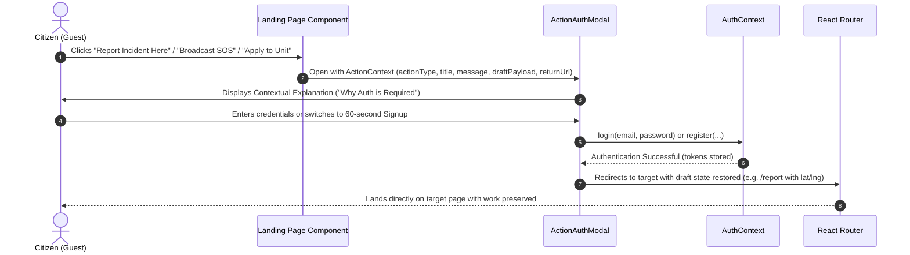
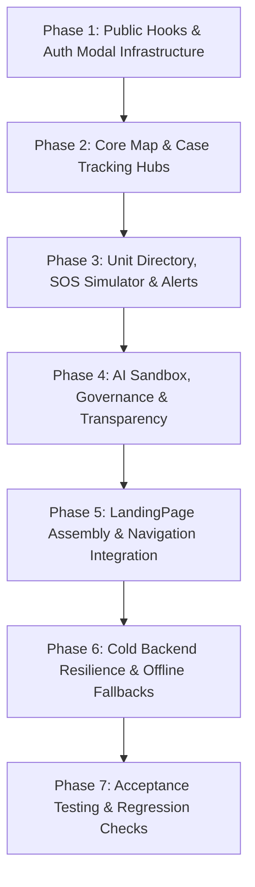

# Nativity Guard — Detailed Landing Page & Guest Exploration Architecture

> **Implementation Plan & Architecture Blueprint**  
> *Target Document:* `landing_page.md`  
> *Objective:* Transform the public front door into a rich, interactive exploration hub where citizens and visitors can experience almost every subsystem of Nativity Guard freely, while seamlessly gating official, legally accountable activities behind an action-aware authentication prompt.

---

## 1. Executive Summary & Design Philosophy

### The Problem with the Current Front Door
Nativity Guard’s current landing page (`frontend/src/pages/LandingPage.tsx`) is a static, conservative text wall. While it respects system truth, it fails to showcase the depth of the platform. A resident arriving from a neighbour's WhatsApp forward sees only a 3-paragraph hero, an abstract 5-stage lifecycle diagram, and a generic "Get Started" button that dumps them immediately onto a signup form. They cannot:
- Verify whether their local community or LGA is covered by an active security unit.
- Inspect the interactive public safety map or safe havens (hospitals, police stations, pharmacies).
- Track an existing case by its tracking ID (`NG-YYYY-NNNNNNNN`).
- Browse active, verified security units, officer ranks, or transparent financial ledgers.
- Experience the emergency SOS workflow, voice/video evidence handling, or response dispatch timelines.
- Preview verified community alerts, weather hazards, or local security advisories.
- Test the Living Local Intelligence AI safety advisor.
- Understand the democratic governance rules (election quotas, recall thresholds, dual-admin closure).

### The "Explore Freely, Authenticate for Official Actions" Strategy
To drive rapid adoption, eliminate citizen skepticism, and demonstrate real utility before demanding personal credentials, Nativity Guard adopts a progressive **"Guest Exploration with Action-Aware Authentication"** model:
1. **Unrestricted Public Exploration**: Visitors can interactively inspect real public data across 8 major functional hubs directly on the landing page and via public preview screens.
2. **Contextual Action Gates**: When a visitor attempts an **official activity** (e.g. broadcasting a live SOS, submitting a formal incident report, applying to join a unit, voting in elections, posting in LGA channels, or rating an officer), the system does not abruptly crash with a `401 Unauthorized` or redirect to a blank login page.
3. **Action-Aware Auth Modal**: The system presents a high-context modal explaining *why* verification is required for this specific action, preserves the user's form state / location draft, offers single-minute citizen signup or login, and resumes the pending action immediately upon authentication.
4. **Strict Truth in Advertising (AGENT.md §11)**: Every public preview widget is powered by real backend data via existing public endpoints (`/api/v1/public/*`, `/api/v1/geo/*`), backed by polished skeleton screens and resilient fallbacks so cold backend spins (e.g., Render free tier) never render broken UI.

---

## 2. Codebase Audit & Public Capabilities Inventory

The backend already contains an extensive suite of public, unauthenticated, rate-limited endpoints designed for public transparency that are currently underutilized by the frontend:

### Existing Backend Public Endpoints
| Endpoint | Handler | Public Capabilities & Data Exposed |
|---|---|---|
| `GET /api/v1/public/cases` | `GetPublicCases` | Active public cases with coordinates coarsened/anonymized via geohash for privacy protection. |
| `GET /api/v1/public/units` | `GetPublicUnits` | Active registered security units across Nigeria with names, LGAs, states, coordinates, and operational radius. |
| `GET /api/v1/public/units/:id/summary` | `GetUnitPublicSummary` | Unit stats: open cases, total cases, active members, officers, operational radius, verified days. |
| `GET /api/v1/public/units/:id/bank-accounts` | `GetPublicBankAccounts` | Verified bank accounts published by the unit for direct citizen donations. |
| `GET /api/v1/public/units/:id/ledger` | `GetPublicUnitLedger` | Append-only financial ledger entries (donations, expenses) with permanent references (`NG-YYYY-...`). |
| `GET /api/v1/public/units/:id/financial-years` | `GetPublicFinancialYears` | Historic financial year snapshots. |
| `GET /api/v1/public/units/:id/financial-summary` | `GetCurrentYearSummary` | Net balance, total in, total out, top expense categories. |
| `GET /api/v1/public/units/:id/rating` | `GetUnitRating` | Bayesian composite rating, tier badge (`bronze` to `diamond`), total review count. |
| `GET /api/v1/public/units/:id/auth` | `GetPublicUnitAuth` | Unit constitution/policy document (quorum %, seat bands, term limits, recall thresholds). |
| `GET /api/v1/public/leaderboard` | `GetPublicLeaderboard` | Top 50 ranked units nationwide by composite score and response volume. |
| `GET /api/v1/public/units/suggest` | `SuggestUnits` | Ranked units by score and geographic proximity. |
| `GET /api/v1/public/blueprint` | `GetBlueprint` | Platform charter: philosophy, 8-stage case lifecycle, security specs, roles, rules. |
| `GET /api/v1/public/platform/donation-info` | `GetPlatformDonationInfo` | Nativity Guard maintenance bank account details. |
| `GET /api/v1/public/platform/supporters` | `ListPublicSupporters` | Public supporter wall of verified donors. |
| `GET /api/v1/geo/states` | `ListStates` | Complete directory of 36 Nigerian states + FCT with capitals and geopolitical zones. |
| `GET /api/v1/geo/lgas?state=` | `ListLGAs` | All 774 Local Government Areas filtered by state. |
| `GET /api/v1/geo/reverse?lat=&lng=` | `ReverseGeocode` | Reverse geocoding to Suburb, LGA, State without trusting client-supplied strings. |
| `GET /api/v1/settings/public` | `GetPublicSettings` | Platform public flags and operational configuration. |

---

## 3. Official Activities vs. Guest Exploration Boundary Matrix

The table below defines the exact line between what a visitor can explore as a guest and what triggers an authentication prompt.

| Subsystem | Free Guest Exploration (No Auth) | Official Activity (Requires Auth) | Auth Trigger & API Route |
|---|---|---|---|
| **Emergency SOS** | - Interactive SOS simulation sandbox<br>- Evidence upload guide (5MB audio, 20MB video)<br>- 60-second response timeline explainer<br>- National emergency hotlines list (112, 199) | - Broadcasting live emergency alert<br>- Sharing live GPS responder tracking<br>- Direct officer dispatch | Clicking "Broadcast Emergency SOS" → Triggers Fast-Track Auth Modal → `POST /api/v1/sos/send` |
| **Incident Reporting** | - Exploring incident categories & priority levels (P1, P2, P3)<br>- Location geocode preview on interactive map<br>- Drafting report text and media attachments locally | - Submitting the incident to an active unit queue<br>- Generating a binding tracking ID<br>- Associating evidence links | Clicking "Submit Official Report" → Triggers Auth Modal (preserves draft) → `POST /api/v1/cases` |
| **Case Tracking** | - Entering any tracking ID (`NG-...`) to check public progress<br>- Viewing public cases feed with status chips<br>- Viewing 8-stage lifecycle & approval loops | - Viewing confidential evidence / investigative notes<br>- Filing citizen counter-statements<br>- Rating officer/unit post-closure | Clicking "Follow Case" or "Submit Counter-Statement" → Auth Modal → `POST /api/v1/ratings`, `PUT /cases/:id/counter-statement` |
| **Safety Map** | - Panning/zooming nationwide Leaflet map<br>- Filtering active units by State/LGA<br>- Viewing unit operational radius circles<br>- Viewing public safe haven POIs (hospitals, police) | - Viewing confidential case coordinates<br>- Logging suspect sightings<br>- Accessing officer patrol routes / dispatch | Clicking "Report Incident Here" or "Log Sighting" → Auth Modal |
| **Security Units Directory** | - Searching units by name, LGA, or State<br>- Viewing unit profiles, verified badges, commander names<br>- Viewing unit ratings, member counts, verified days<br>- Viewing published bank accounts for direct donation | - Submitting application to join unit<br>- Applying as an active duty officer<br>- Viewing private member rosters | Clicking "Apply to Join Unit" or "Enlist as Officer" → Auth Modal → `POST /api/v1/units/apply` |
| **Community Feed & LGA** | - Previewing verified official safety advisories<br>- Reading public LGA announcements<br>- Viewing community events and dates | - Publishing new community posts<br>- Replying in thread discussions<br>- Joining LGA convergence groups<br>- Flagging/reporting inappropriate content | Clicking "Post Announcement", "Reply", or "Join LGA Group" → Auth Modal → `POST /api/v1/community/posts` |
| **AI Safety Assistant** | - Testing interactive safety prompts in sandbox (e.g. night travel precautions, burglary de-escalation)<br>- Reading smart safety guides | - Personalized location risk analysis based on profile<br>- AI incident report generation<br>- Saving chat history | Clicking "Analyze My Neighborhood" or "Save Consultation" → Auth Modal → `POST /api/v1/ai/chatbot` |
| **Governance & Accountability** | - Reading UnitAuth constitution & bylaws<br>- Viewing seat bands (12-20 → 5, 21-40 → 7, etc.)<br>- Inspecting democratic recall thresholds<br>- Inspecting two-admin closure audit trails | - Casting votes in admin elections<br>- Signing revocation petitions<br>- Approving or rejecting case closures | Clicking "Cast Vote" or "File Recall Petition" → Auth Modal → `POST /api/v1/elections/:id/vote` |
| **Financial Transparency** | - Inspecting unit append-only ledgers<br>- Viewing verified donation bank details<br>- Viewing platform supporter wall | - Uploading transfer receipts for verification<br>- Creating unit expense transactions<br>- Confirming disbursements | Clicking "Record Donation" or "Manage Accounts" → Auth Modal → `POST /api/v1/bank/donations` |

---

## 4. The 8 Interactive Landing Page Hubs (UX & Architecture)

The landing page (`LandingPage.tsx`) will be structured into 8 modular, interactive sections below a modern glass navigation header:

```
┌────────────────────────────────────────────────────────────────────────┐
│  LandingNavbar: Brand Logo | Live System Status | 5 Theme Picker | Auth │
├────────────────────────────────────────────────────────────────────────┤
│  1. HeroSection: Mission Statement + Quick Action Badges + Value Prop  │
├────────────────────────────────────────────────────────────────────────┤
│  2. PublicSafetyMapSection: Interactive Leaflet Map + LGA Search       │
├────────────────────────────────────────────────────────────────────────┤
│  3. CaseLifecycleSection: 8-Stage Cycle + Live Case Tracker + Lookup   │
├────────────────────────────────────────────────────────────────────────┤
│  4. UnitsDirectorySection: Verified Units + Radius + Direct Donations  │
├────────────────────────────────────────────────────────────────────────┤
│  5. SosSimulatorSection: Emergency Flow Sandbox + Voice/Video Preview  │
├────────────────────────────────────────────────────────────────────────┤
│  6. CommunityAlertsSection: Real-time Weather & Security Advisories    │
├────────────────────────────────────────────────────────────────────────┤
│  7. AiSafetySandboxSection: Living Local Intelligence AI Advisor Demo  │
├────────────────────────────────────────────────────────────────────────┤
│  8. GovernanceAndFinanceSection: UnitAuth Constitution + Public Ledger │
├────────────────────────────────────────────────────────────────────────┤
│  LandingFooter: Blueprint Summary, Terms, Support, Emergency Hotlines  │
└────────────────────────────────────────────────────────────────────────┘
```

### Hub 1: Hero & Real-Time Pulse (`LandingHero.tsx`)
- **Visuals**: Embedded in the responsive `ng-public-scene` carved-mask atmosphere with the `dawn-hero` treatment.
- **Components**:
  - Live System Pulse badge: Displays real-time aggregate count: `N Verified Units Active Across N States`.
  - Headline: *"Community safety, on the record. From distress alert to verified resolution."*
  - Dual CTAs:
    - Primary CTA: *"Explore the Platform"* (smooth-scrolls to the Interactive Safety Map).
    - Secondary CTA: *"File an Incident"* (opens the Action-Aware Report Flow).
    - Emergency Link: High-visibility emergency pill: *"Need urgent help? View Emergency SOS Simulator & Hotlines"*.
  - Accountability Stat Bar: 3 live metrics fetched via `/api/v1/public/cases` and `/api/v1/public/units`:
    - Total Active Registered Units
    - Verified Resolution Rate (%)
    - Maximum Media Cap: 5MB Voice / 20MB Video with Deduplication

### Hub 2: Interactive Public Safety Map & Unit Coverage Locator (`PublicSafetyMapSection.tsx`)
- **Purpose**: Let any citizen type their LGA/State or click "Locate Me" to see which security unit covers their doorstep.
- **UX & Controls**:
  - State & LGA Dropdowns populated dynamically via `/api/v1/geo/states` and `/api/v1/geo/lgas`.
  - "Locate My Area" button using browser geolocation + `/api/v1/geo/reverse` to auto-focus the map.
  - Interactive Leaflet Map using existing `MapView.tsx`:
    - Plots active security unit headquarters with badge icons.
    - Renders translucent circular overlays representing each unit’s verified `operationalRadius` (e.g. 5km, 15km).
    - Plots public safe haven POIs (Police divisions, General Hospitals, registered pharmacies).
    - Plots coarsened, anonymized public cases (`is_public = true`, coordinates snapped to geohash center to protect victims).
  - Selected Unit Flyout Card: Clicking a unit displays its verified badge, commander name, active officer strength, contact phone, and a "View Unit Profile" button.
  - "Report Incident Here" button on map click: Captures coordinates and triggers the Action-Aware Auth Modal with prefilled location.

### Hub 3: Case Lifecycle & Live Public Case Tracker (`CaseLifecycleSection.tsx`)
- **Purpose**: Demystify what happens after an incident is reported, proving accountability.
- **UX & Controls**:
  - **Live Tracking Search Box**: Input field accepting any Tracking ID (`NG-YYYY-NNNNNNNN`).
    - Submitting fetches public case status, timestamped timeline milestones, assigned unit, and current phase.
    - Anonymity protection: Never exposes reporter identity, officer names, or internal evidence.
  - **Interactive 8-Stage Lifecycle Stepper**:
    - Stage 1: `pending` (Awaiting unit triage)
    - Stage 2: `assigned` (Officer assigned)
    - Stage 3: `dispatched` (En route)
    - Stage 4: `on_scene` (Officer arrived)
    - Stage 5: `investigating` (Active evidence gathering)
    - Stage 6: `pending_admin_review` (Closure submission)
    - Stage 7: `admin_changes_requested` (Returned with instructions — loop back)
    - Stage 8: `closed` (2-admin verified approval)
  - **Live Public Cases Carousel/Feed**: Fetches the 6 most recent public cases from `/api/v1/public/cases` showing real status progression in real time.

### Hub 4: Verified Security Units Directory & Direct Donation Showcase (`UnitsDirectorySection.tsx`)
- **Purpose**: Connect citizens with independent community security units and demonstrate direct financial transparency.
- **UX & Controls**:
  - Search by unit name, state, or LGA.
  - Unit Cards displaying:
    - Verified Shield & Verification Date badge.
    - Composite Rating Score (e.g. `4.8 ★` with tier badge `Gold` / `Diamond`).
    - Formation year, active officer count, and operational area.
    - Direct Bank Account Drawer: Clicking "Support this Unit" displays the unit’s verified bank details (Account Name, Bank Name, Account Number) with a 1-click copy button.
    - Disclaimer: *"Nativity Guard never touches community donations. Funds transfer directly to the unit's verified bank account."*
  - "Join Unit" / "Apply as Officer" Button: Launches the Action-Aware Auth Modal with the unit ID attached.

### Hub 5: Emergency SOS Simulator & Readiness Lab (`SosSimulatorSection.tsx`)
- **Purpose**: Educate citizens on how Nativity Guard solves the delayed emergency response crisis without making false promises.
- **UX & Controls**:
  - Interactive Step-by-Step Simulator:
    - Step 1: *The Panic Trigger* — 1-tap activation with immediate reverse-geocoding.
    - Step 2: *Evidence Attachment* — Live simulation of the 5MB voice recording and 20MB video recording with client-side SHA-256 deduplication explanation.
    - Step 3: *Unit Dispatch* — How the nearest unit receives the alert on the live tactical map with sound alarm.
    - Step 4: *Live Responder Tracking* — Demonstration of real-time officer foreground location updates.
  - Prominent "Emergency Hotlines" Drawer: Direct tap-to-call buttons for Nigeria emergency response (112, 199, FRSC 122).
  - Real "Trigger Emergency SOS" button: Clearly labelled with an alert chip; clicking prompts instant login/guest verification so false alarms are prevented.

### Hub 6: Community Safety Bulletins & Alerts Ticker (`CommunityAlertsSection.tsx`)
- **Purpose**: Showcase verified local security advisories and weather alerts.
- **UX & Controls**:
  - Live ticker of recent public safety notices, weather advisories, and community broadcasts.
  - Filter by Geopolitical Zone / State.
  - "Subscribe for SMS / WhatsApp Broadcasts" CTA: Triggers the Action-Aware Auth Modal.

### Hub 7: AI Safety Assistant Sandbox ("Living Local Intelligence") (`AiSafetySandboxSection.tsx`)
- **Purpose**: Showcase the platform’s localized AI intelligence that reasons over facts and provides practical community safety guidance.
- **UX & Controls**:
  - Interactive chat simulator with pre-loaded prompt chips:
    - *"What steps should our community take if cattle rustling is suspected?"*
    - *"How do I verify if a night security guard is registered with Nativity Guard?"*
    - *"Safety precautions for market women travelling before dawn."*
    - *"What should I do if an officer asks for an unauthorized cash fee?"*
  - Instant interactive preview response demonstrating Nativity Guard's Living Local Intelligence guidelines: facts over models, presumed innocence, no-vigilantism advice, and emergency disclaimers.
  - "Ask Custom Question" Input: Typing a custom prompt opens the Action-Aware Auth Modal to continue the consultation in the full AI Assistant.

### Hub 8: Democratic Governance & Transparency Center (`GovernanceAndFinanceSection.tsx`)
- **Purpose**: Prove that Nativity Guard eliminates vigilantism through auditable democratic oversight.
- **UX & Controls**:
  - **The 4 Cardinal Rules**:
    1. *Unit Access is NOT Case Access*: Officers only see cases explicitly assigned to them.
    2. *Two-Admin Closure Rule*: Officers cannot close their own cases; closure requires approval from at least 2 independent administrators.
    3. *Democratic Recall*: Any admin can be removed with 10+ verified member votes + Head Admin sign-off; Head Admins removable by simple majority.
    4. *Presumed Innocence*: Suspects have self-view rights and see only public-safe status, never investigative evidence.
  - **Platform Transparency Wall**: Live list of public donors from `/api/v1/public/platform/supporters` and link to full `/about` blueprint.

---

## 5. Action-Aware Authentication Flow Architecture

When a guest user clicks an official action anywhere on the landing page, the application uses an **Action-Aware Authentication Flow** rather than an abrasive route bounce.



### Key Technical Properties of the Auth Modal:
1. **Context Awareness**: The modal title and badge dynamically reflect the triggered action:
   - *Emergency SOS*: Urgent red styling, explains legal verification to prevent false dispatches.
   - *Incident Report*: Green styling, shows draft recovery message: *"Your pin at Kubwa LGA will be saved"*.
   - *Unit Application*: Blue styling, explains background vetting requirement.
   - *Community Post*: Amber styling, explains anti-spam / community moderation rules.
2. **Draft State Preservation**: Uses sessionStorage / localStorage key `ng_pending_action` storing `{ action: string, data: any, returnUrl: string, timestamp: number }`. When login or signup completes, the user is redirected to `returnUrl` and the form immediately pre-populates with `data`.
3. **No Dead Ends**: If the user cancels the modal, they stay exactly where they were on the landing page without losing scroll position or search filters.

---

## 6. Implementation Architecture & File Changes

### 6.1 Directory Structure to Create
```
frontend/src/components/landing/
├── ActionAuthModal.tsx             # Contextual auth modal for official actions
├── LandingNavbar.tsx               # Top glass navigation bar with theme picker & links
├── LandingHero.tsx                 # Value proposition, system pulse & stats
├── PublicSafetyMapSection.tsx      # Leaflet map with LGA filter, coverage, POIs
├── CaseLifecycleSection.tsx        # 8-stage visualizer, live public feed, tracking lookup
├── UnitsDirectorySection.tsx       # Searchable unit cards, verified badges, direct donation
├── SosSimulatorSection.tsx         # Interactive emergency SOS simulator & hotlines
├── CommunityAlertsSection.tsx      # Live alerts ticker & weather warnings
├── AiSafetySandboxSection.tsx      # Interactive prompt sandbox for safety advisor
├── GovernanceSection.tsx           # UnitAuth rules, election quotas, accountability
├── FinancialTransparencySection.tsx# Append-only ledger preview & supporter wall
├── LandingFooter.tsx               # Legal disclaimers, blueprint links, emergency numbers
└── types.ts                        # Types for landing page widgets and actions
```

### 6.2 Frontend Hooks to Create / Extend
- `frontend/src/hooks/usePublicCases.ts`:
  - Queries `GET /api/v1/public/cases` with 60-second stale time.
  - Transforms and filters public cases for the map and case tracker.
- `frontend/src/hooks/usePublicUnits.ts`:
  - Queries `GET /api/v1/public/units` (all active units) and `GET /api/v1/public/units/suggest`.
- `frontend/src/hooks/usePublicLeaderboard.ts`:
  - Queries `GET /api/v1/public/leaderboard` for top-ranked community units.
- `frontend/src/hooks/usePublicBlueprint.ts`:
  - Queries `GET /api/v1/public/blueprint` for platform statistics, case lifecycle metadata, and rules.
- `frontend/src/hooks/usePublicSupporters.ts`:
  - Queries `GET /api/v1/public/platform/supporters` and `/api/v1/public/platform/donation-info`.
- `frontend/src/hooks/usePendingAction.ts`:
  - Manages storing, retrieving, and clearing pending guest actions across login/signup lifecycles.

### 6.3 Routing Architecture in `frontend/src/App.tsx`
Currently, `/map`, `/units`, and `/units/:id` are trapped inside `ProtectedShell`. We will update the routing so that:
1. `/` remains `RootRoute`:
   - If authenticated: renders `<ProtectedShell><HomeRoute /></ProtectedShell>`.
   - If anonymous: renders `<LandingPage />`.
2. Public Guest Exploratory Routes:
   - Enable unauthenticated preview access to `/units` and `/units/:id` with read-only views for public summaries, bank accounts, and ledgers.
   - Any official button on these pages (like "Join Unit" or "Cast Vote") calls `usePendingAction` and opens `ActionAuthModal`.

---

## 7. Step-by-Step Implementation Roadmap



### Phase 1: Public Hooks & Action-Auth Infrastructure
1. Create `frontend/src/hooks/usePublicCases.ts` for `GET /api/v1/public/cases`.
2. Create `frontend/src/hooks/usePublicLeaderboard.ts` for `GET /api/v1/public/leaderboard`.
3. Create `frontend/src/hooks/usePublicBlueprint.ts` for `GET /api/v1/public/blueprint`.
4. Create `frontend/src/hooks/usePublicSupporters.ts` for `GET /api/v1/public/platform/supporters`.
5. Create `frontend/src/hooks/usePendingAction.ts` with helper methods:
   - `setPendingAction(action)`
   - `getPendingAction()`
   - `clearPendingAction()`
   - `executePendingAction()`
6. Create `frontend/src/components/landing/ActionAuthModal.tsx` using the base `Modal` component, supporting tabbed Sign In / Register, context messaging, and auto-resume.

### Phase 2: Core Map & Case Tracking Hubs
1. Build `PublicSafetyMapSection.tsx`:
   - State and LGA picker hooked to `useGeoStates` and `useGeoLGAs`.
   - Geolocation button hooked to `useLocation` and `useReverseGeocode`.
   - Leaflet `MapView` configured in `view` mode with unit coverage circles and coarse incident markers.
   - Quick unit preview drawer with direct donation bank info.
2. Build `CaseLifecycleSection.tsx`:
   - Live Case Tracking input with instant status search.
   - Visual 8-stage interactive stepper explaining field phase vs review loop.
   - Live stream of recent public cases (`usePublicCases`).

### Phase 3: Unit Directory, SOS Simulator & Alerts
1. Build `UnitsDirectorySection.tsx`:
   - Searchable card grid of units (`useUnits` / `usePublicUnits`).
   - Unit detail badges: Verified status, operational radius, officer count, rating.
   - 1-click Bank Details modal for direct community donations.
2. Build `SosSimulatorSection.tsx`:
   - Interactive 4-step emergency walkthrough (Panic -> Media -> Dispatch -> Tracking).
   - Voice note (5MB) and Video (20MB) evidence deduplication explainer.
   - Nigeria Emergency Hotlines drawer (112, 199, 122).
3. Build `CommunityAlertsSection.tsx`:
   - Live ticker of public security bulletins, weather warnings, and safety advisories.

### Phase 4: AI Sandbox, Governance & Transparency
1. Build `AiSafetySandboxSection.tsx`:
   - Interactive prompt chips for common rural/peri-urban security questions.
   - Grounded Living Local Intelligence advice cards.
   - Action gate to open full AI Safety Assistant.
2. Build `GovernanceSection.tsx`:
   - Interactive visualizer of UnitAuth rules: seat bands, 50% quorum, 12-month terms.
   - The Two-Admin case closure rule explainer.
   - The Democratic Recall threshold explainer.
3. Build `FinancialTransparencySection.tsx`:
   - Platform maintenance donation details (`GET /public/platform/donation-info`).
   - Confirmed public supporters wall (`GET /public/platform/supporters`).

### Phase 5: LandingPage Assembly & Navigation Integration
1. Build `LandingNavbar.tsx`:
   - Nativity Guard Logo + System Status indicator.
   - Anchor links: Map, Case Tracker, Units, SOS Guide, Governance, Transparency.
   - Theme Selector dropdown supporting all 5 themes.
   - Sign In and Sign Up buttons.
2. Build `LandingHero.tsx` with dynamic pulse metrics.
3. Assemble all 8 hubs in `frontend/src/pages/LandingPage.tsx`.
4. Ensure full responsive drawer compatibility for mobile viewports below `lg` breakpoint.

### Phase 6: Cold Backend Resilience & Offline Fallbacks
1. **Fallback Data Caches**:
   - Because Render backends may take 15–30 seconds to wake from idle, each public hook will supply instant fallback data (sample Lagos/Abuja/Kaduna active units, sample case lifecycle states, verified blueprint constants) so the page renders immediately without layout shifts or error flashes.
   - As soon as the backend responds, the live data seamlessly hydrates the components.
2. **Offline Detection**:
   - Integrated with existing `OfflineBanner.tsx` and React Query's `networkMode: 'offlineFirst'`.

### Phase 7: Acceptance Testing & Regression Checks
1. **Visual Acceptance**:
   - Verify `ng-public-scene` carved-mask background renders correctly across all 5 user-selectable themes (`dawn-canopy`, `lagos-highlife`, `savanna-stone`, `niger-delta-dusk`, `benin-bronze`).
   - Verify mobile drawer and desktop navbar work seamlessly across viewport widths (`sm`, `md`, `lg`, `xl`).
2. **Security & Privacy Acceptance**:
   - Verify that anonymous case coordinates are properly coarsened and never leak precise victim locations.
   - Verify that officer identities, internal notes, and sensitive evidence are completely absent from public payloads.
   - Verify that client-supplied place names are never trusted; coordinates are always derived.
3. **Automated Testing**:
   - Run backend tests: `go test ./...` and `go vet ./...`.
   - Run frontend build: `npm run build`.
   - Run Vitest suite: `npm run test` ensuring no regressions.

---

## 8. AGENT.md Compliance Checklist

- [x] **No Redesign of Architecture**: Strictly follows Go/Gin backend and React 19/Tailwind frontend conventions.
- [x] **Preserve Carved-Mask Artwork & Themes**: Uses `.ng-public-scene` and theme variables from `theme.css`.
- [x] **No Fake or "Coming Soon" Traps**: Every public control connects to real backend data and real workflows.
- [x] **Strict Geolocation Derivation**: Never accepts client-supplied place names; uses verified coordinates and reverse geocoding.
- [x] **Unit Access is NOT Case Access**: Enforces privacy boundaries; public views only expose public-safe DTOs.
- [x] **Two-Admin Rule Preserved**: Highlights real accountability rules on the landing page without compromising enforcement.
- [x] **Testing & Verification**: Specifies `npm run build` and `go test ./...` validation requirements before shipping.

---
*Document prepared for direct implementation. Ready to execute upon approval.*

